<p align="center">
  
</p>

A patient management system for a veterinary clinic that only treats cats.

Node.js · Express · PostgreSQL


The web page lets staff add a patient, search by name or breed, edit a record and delete it. Behind it is a PostgreSQL database designed for the whole clinic: patients, staff, veterinarians and support staff, appointments and their types, treatments, prescriptions, clinics and stock. The full schema and example queries are in [`SQL_Kodları`](SQL_Kodları).

<p>
  
  
</p>

## Running it

You need Node.js 14 or newer and PostgreSQL 12 or newer.

1. Create the tables by running the statements in `SQL_Kodları` on your database.
2. Set your database user and password in the `Pool` settings at the top of `kedi_hastanesi1/index.js`.
3. Start the server:

```bash
git clone https://github.com/omeraydin00/DatabaseManagmentSystems-Kedi_Hastanesi.git
cd DatabaseManagmentSystems-Kedi_Hastanesi/kedi_hastanesi1
npm install
node index.js
```

Then open http://localhost:3000.

Made for the Database Management Systems course at Sakarya University.
