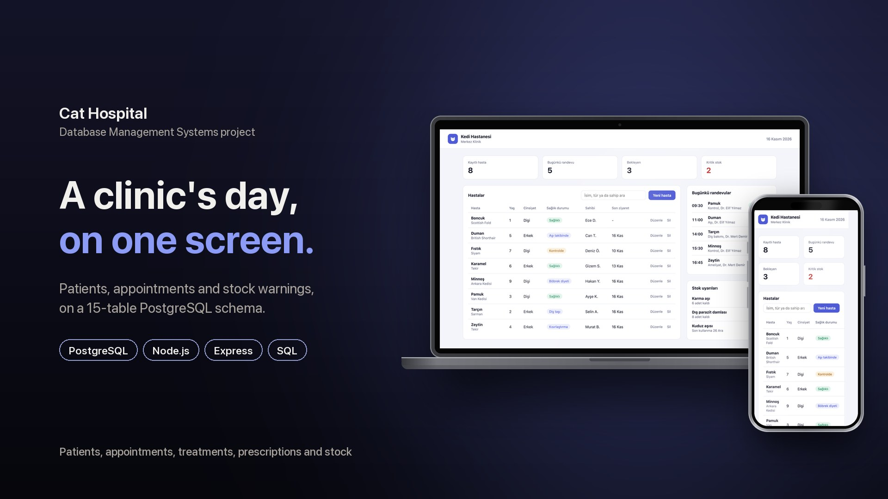
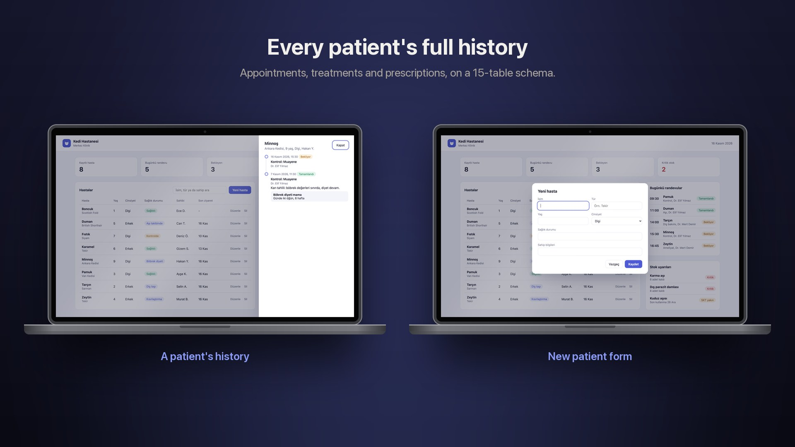
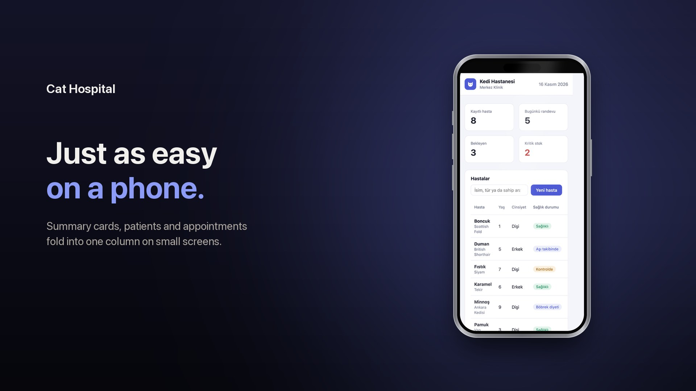
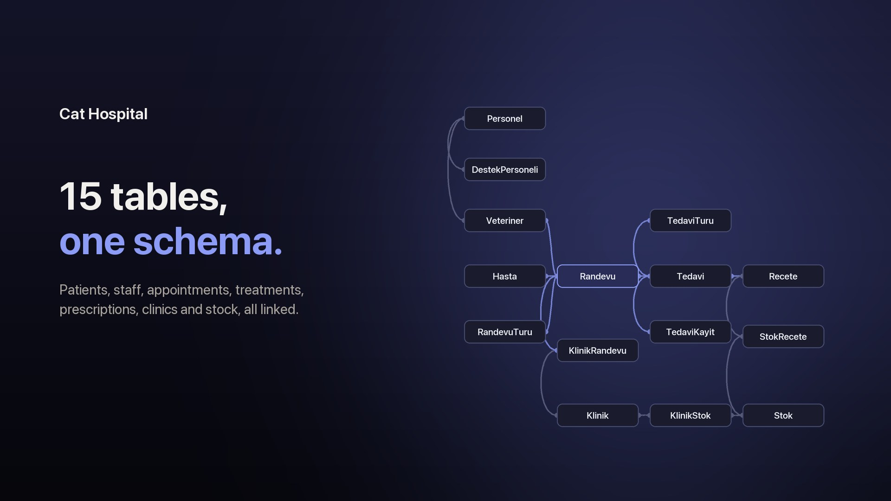
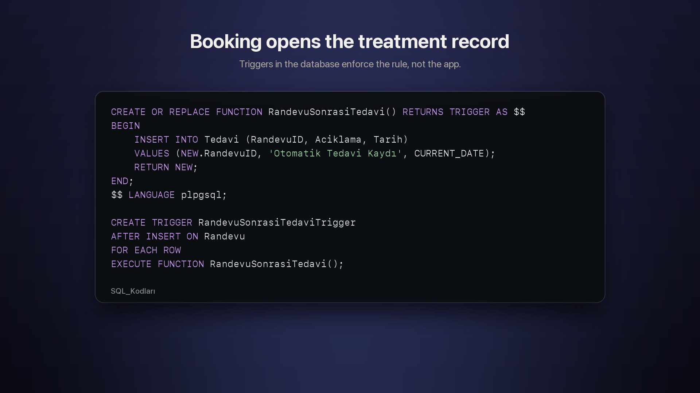

<p align="center">
  
</p>

A patient management system for a veterinary clinic that only treats cats.

Node.js · Express · PostgreSQL



The page shows the clinic's day at a glance: how many patients are registered, today's appointments and which of them are still waiting, and the stock that is running low or close to its expiry date. Staff can add a patient, search by name, breed or owner, edit a record, and open a patient to see every appointment with its treatment and prescriptions.

## Screens





<details>
<summary>Full-size screenshots</summary>
<br/>


</details>

## The database

Behind the page is a PostgreSQL schema designed for the whole clinic, 15 tables in all, with stored procedures and triggers. Booking an appointment opens its treatment record on its own, and a patient with appointments cannot be deleted, so their history is kept. The full schema is in [`SQL_Kodları`](SQL_Kodları).





## Running it

You need Node.js 18 or newer and PostgreSQL 12 or newer.

```bash
git clone https://github.com/omeraydin00/DatabaseManagmentSystems-Kedi_Hastanesi.git
cd DatabaseManagmentSystems-Kedi_Hastanesi/kedi_hastanesi1
npm install

createdb kedi_hastanesi
npm run db      # the schema from SQL_Kodları and some example data
npm start
```

Then open http://localhost:3000.

The connection uses PostgreSQL's usual environment variables (`PGHOST`, `PGUSER`, `PGPASSWORD`, `PGPORT`, `PGDATABASE`), so set those if your database is not the local default. The example data in [`db/ornek-veri.sql`](kedi_hastanesi1/db/ornek-veri.sql) is made up and dated from today, so there is always something on today's list.

## Structure

```
SQL_Kodları             the schema, stored procedures and triggers
kedi_hastanesi1/
├── index.js            the Express server and its routes
├── db/ornek-veri.sql   made-up example data
└── public/             the page: index.html, script.js, style.css
```

Made for the Database Management Systems course at Sakarya University.
