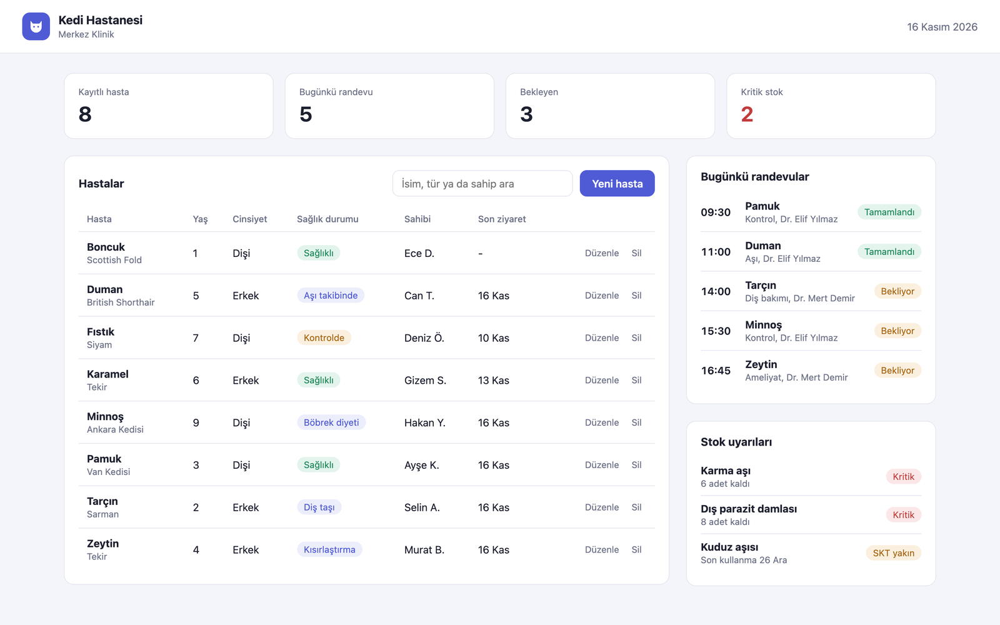
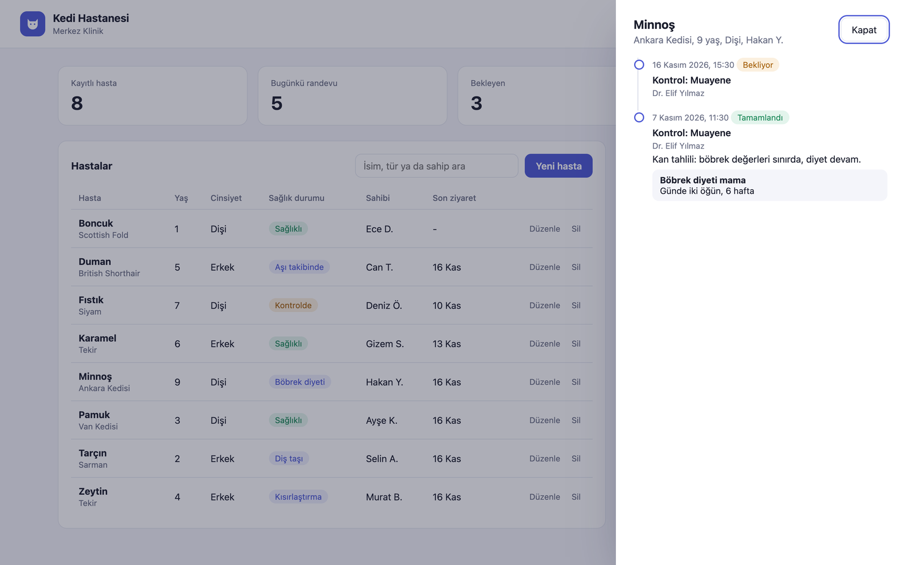
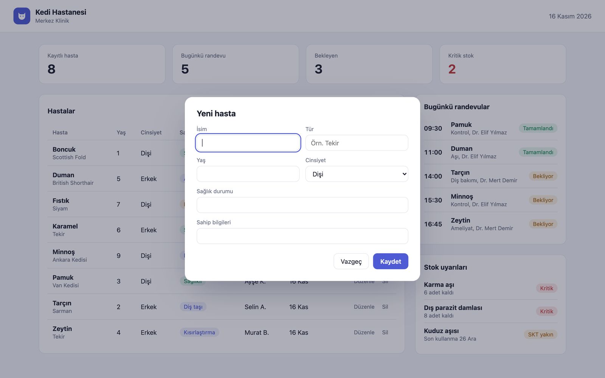

<p align="center">
  
</p>

A patient management system for a veterinary clinic that only treats cats.

Node.js · Express · PostgreSQL



The page shows the clinic's day at a glance: how many patients are registered, today's appointments and which of them are still waiting, and the stock that is running low or close to its expiry date. Staff can add a patient, search by name, breed or owner, edit a record, and open a patient to see every appointment with its treatment and prescriptions.

Behind it is a PostgreSQL database designed for the whole clinic: patients, staff, veterinarians and support staff, appointments and their types, treatments, prescriptions, clinics and stock, 15 tables in all, with stored procedures and triggers. Booking an appointment opens its treatment record on its own, and a patient with appointments cannot be deleted, so their history is kept. The full schema is in [`SQL_Kodları`](SQL_Kodları).

<p>
  
  
</p>

## Running it

You need Node.js 18 or newer and PostgreSQL 12 or newer.

```bash
git clone https://github.com/omeraydin00/DatabaseManagmentSystems-Kedi_Hastanesi.git
cd DatabaseManagmentSystems-Kedi_Hastanesi/kedi_hastanesi1
npm install

createdb kedi_hastanesi
npm run db      # the schema from SQL_Kodları and some example data
npm start
```

Then open http://localhost:3000.

The connection uses PostgreSQL's usual environment variables (`PGHOST`, `PGUSER`, `PGPASSWORD`, `PGPORT`, `PGDATABASE`), so set those if your database is not the local default. The example data in [`db/ornek-veri.sql`](kedi_hastanesi1/db/ornek-veri.sql) is made up and dated from today, so there is always something on today's list.

Made for the Database Management Systems course at Sakarya University.
